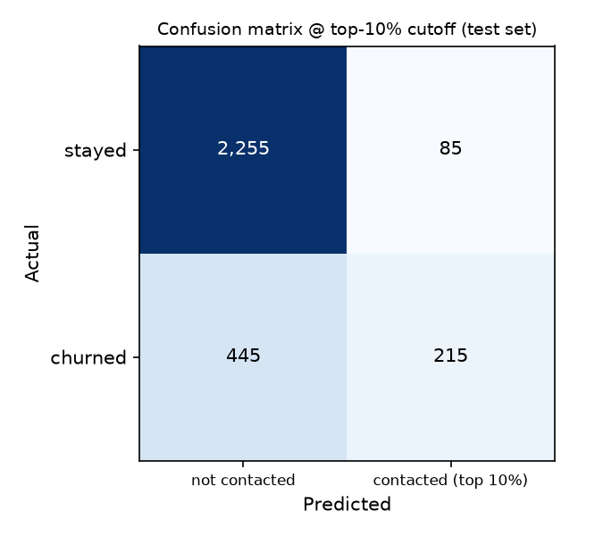
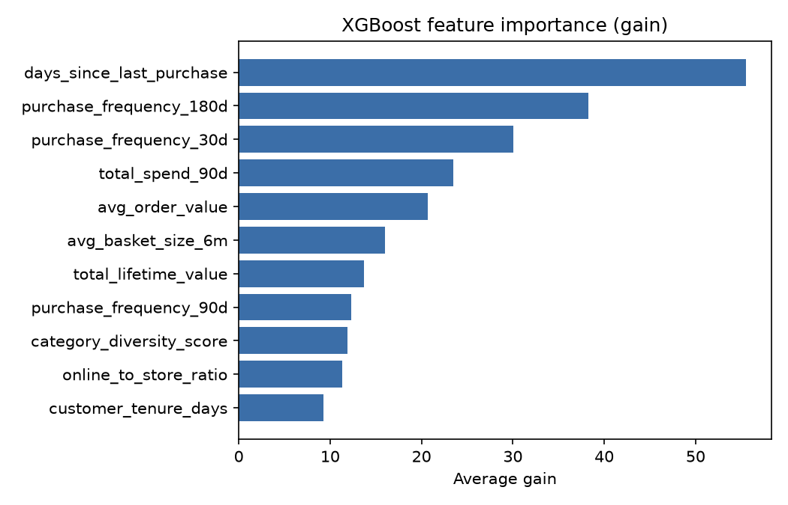

# Lab 3 Evaluation Report (Track A: churn)

XGBoost 3.4.1, seed 42, stratified 70/30 split (test n=3000); 15% of the training split was held out for early stopping so the test set was used only for final evaluation. Data came from the Feature Store offline store via Athena.

| Metric | Value | Threshold |
|---|---|---|
| AUC-ROC (test) | 0.7846 | report only |
| Precision @ top 10% | 0.7167 | >= 0.50 |
| Recall @ top 10% | 0.3258 | >= 0.25 |
| Recency-only baseline AUC | 0.7203 | n/a |
| AUC lift over baseline | 0.0643 | CI must exclude 0 |
| Lift 95% CI (paired bootstrap, 2,000 resamples) | [0.0446, 0.084] | excludes 0 |

Scale_pos_weight was derived as negatives/positives from the training rows (about 22% churners), not hardcoded. The 1.7 SageMaker container would give slightly different numbers than XGBoost 3.4.1.

## Experiments
| run | max_depth | eta | num_round | risk_score | auc | p@10% | r@10% |
|---|---|---|---|---|---|---|---|
| final-graded | 4 | 0.05 | 400 | False | 0.7846 | 0.7167 | 0.3258 |
| d4-eta0.05-n400-with-risk-score | 4 | 0.05 | 400 | True | 0.7842 | 0.7133 | 0.3242 |
| d4-eta0.05-n400 | 4 | 0.05 | 400 | False | 0.7846 | 0.7167 | 0.3258 |
| d6-eta0.1-n200 | 6 | 0.1 | 200 | False | 0.7796 | 0.7 | 0.3182 |
| d3-eta0.1-n300 | 3 | 0.1 | 300 | False | 0.7785 | 0.7267 | 0.3303 |
| smoke | 6 | 0.1 | 200 | False | 0.7796 | 0.7 | 0.3182 |

The run with risk_score=True includes churn_risk_score, a recency heuristic; the graded run excludes it so the baseline comparison is not circular.

## Confusion matrix (top-10% cutoff) and feature importance

Top features by gain: days_since_last_purchase (23%), purchase_frequency_180d (16%), purchase_frequency_30d (12%). Lowest: category_diversity_score (5%), online_to_store_ratio (5%), customer_tenure_days (4%).

## Slice evaluation by loyalty tier (`lab3-evidence/slice-evaluation.csv`)
| tier | n | positives | auc | recall | too_small | recall_gap_flag | aggregate_recall |
|---|---|---|---|---|---|---|---|
| Bronze | 1071 | 361 | 0.7606 | 0.4266 | False | False | 0.3258 |
| Gold | 483 | 52 | 0.7551 | 0.1154 | False | True | 0.3258 |
| Platinum | 307 | 21 | 0.8765 | 0.1429 | True | True | 0.3258 |
| Silver | 1139 | 226 | 0.7179 | 0.2301 | False | False | 0.3258 |

The weakest tier with enough data is **Silver** (AUC 0.7179, recall 0.2301, n=1139, 226 churners). Tiers too small to conclude from (fewer than 30 test positives): Platinum. Tiers with recall more than 10pp below aggregate: Gold, Platinum. Recall uses the global top-10% cutoff, i.e. the share of each tier's churners the contact budget would reach.

## Slice discussion
Among tiers with enough data, Silver has the lowest AUC (0.7179, n=1,139, 226 churners) and Gold has the lowest recall (0.1154, n=483, 52 churners). Bronze is strongest on recall (0.4266, n=1,071, 361 churners). Platinum shows the highest AUC (0.8765) but has only 21 test churners (n=307), so neither its AUC nor its recall (0.1429) can support a conclusion. The low Gold and Platinum recall is mostly a base-rate effect of using one global top-10% cutoff: Bronze churns at about 33% versus about 11% for Gold and 8% for Platinum, so the highest-scored customers are mostly Bronze. It is not evidence that the model ranks Gold customers badly (Gold AUC 0.7551 is close to Bronze 0.7606); it means a single global cutoff under-serves higher tiers.
